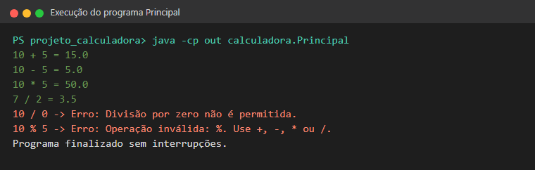
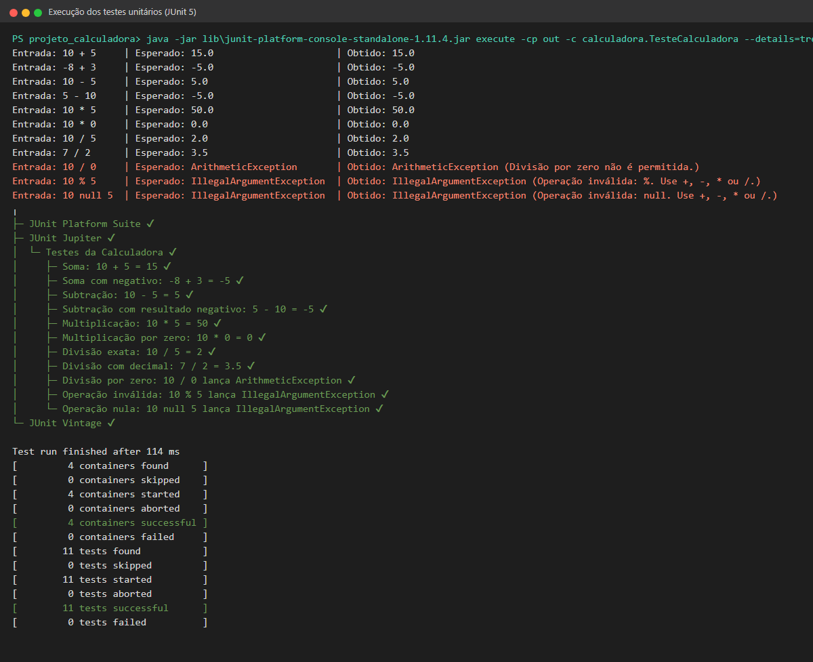
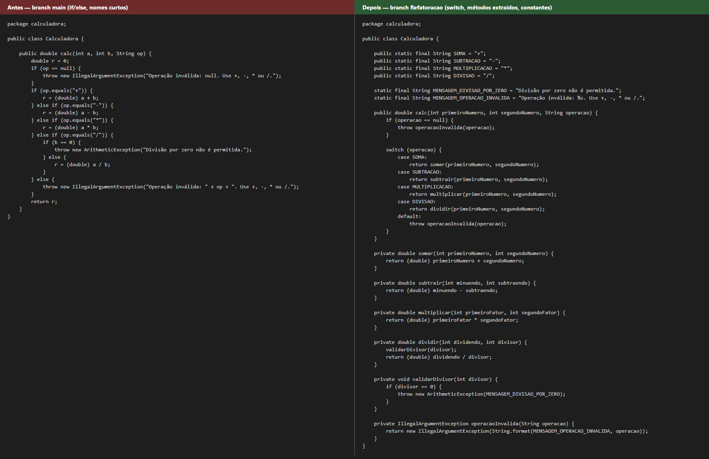
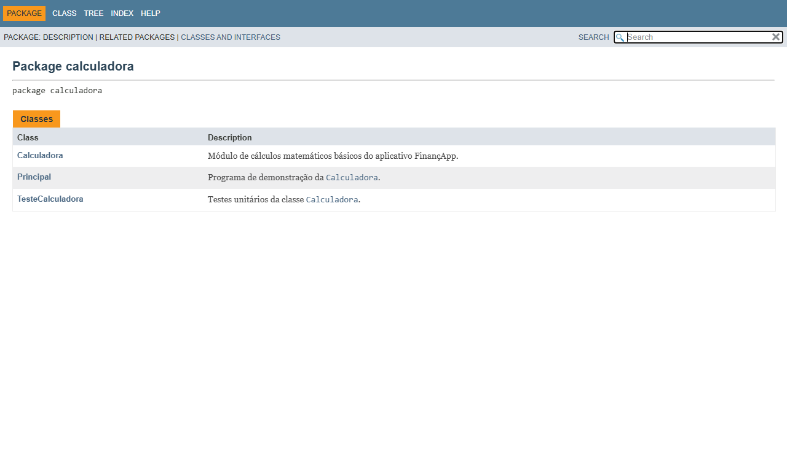
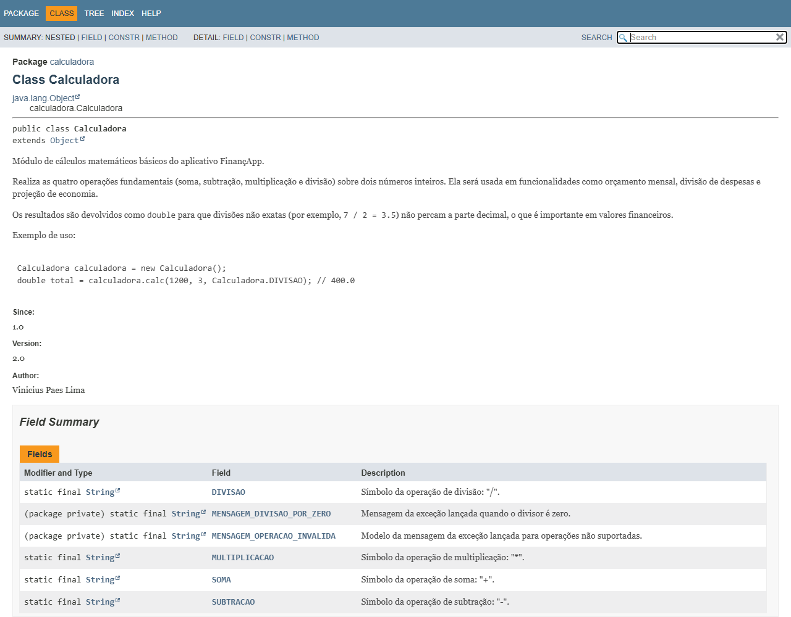
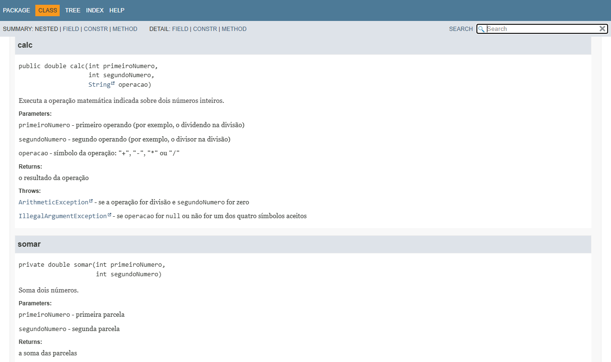

# Projeto Calculadora — FinançApp

> Projeto acadêmico de qualidade de software: testes, tratamento de erros, refatoração, documentação técnica e versionamento.

---

## 1. Identificação do Projeto

| Campo | Informação |
|---|---|
| **Projeto** | projeto_calculadora |
| **Contexto** | FinançApp — aplicativo mobile de controle de finanças pessoais (startup fictícia) |
| **Aluno** | Vinicius Paes Lima |
| **RA** | 252015 |
| **Curso** | Análise e Desenvolvimento de Sistemas (ADS) |
| **Disciplina** | UX/UI |
| **Professor** | Daniel Ohata |
| **Semestre** | 2026.2 |

---

## 2. Visão Geral

Este projeto implementa, em Java, o **módulo de cálculos matemáticos básicos** da startup fictícia **FinançApp**. O módulo será reutilizado em funcionalidades do aplicativo como:

- cálculo de orçamento mensal;
- divisão de despesas;
- projeção de economia financeira;
- cálculos auxiliares usados pelo sistema.

Além de funcionar, o código foi desenvolvido aplicando práticas de qualidade de software:

- testes unitários automatizados (JUnit 5);
- tratamento de erros;
- refatoração;
- documentação técnica (comentários e JavaDoc);
- versionamento com Git e GitHub;
- manutenção e organização do código.

---

## 3. Problema

A equipe da FinançApp precisava de um módulo matemático reutilizável. Como ele será usado por várias partes do aplicativo, não basta que funcione: precisa ser confiável e fácil de manter. Por isso o código precisa ter:

- código legível e organizado;
- testes automatizados;
- tratamento de falhas (divisão por zero e operações inválidas) sem derrubar o programa;
- documentação técnica;
- controle de versões;
- facilidade de manutenção.

---

## 4. Objetivo

### 4.1 Objetivo Geral

Desenvolver uma calculadora em Java aplicando práticas de qualidade de software: testes, tratamento de erros, documentação, refatoração e versionamento.

### 4.2 Objetivos Técnicos

1. Implementar as operações de soma, subtração, multiplicação e divisão.
2. Tratar entradas inválidas (operador não suportado ou nulo).
3. Impedir a divisão por zero.
4. Criar testes unitários automatizados para todas as operações e erros.
5. Refatorar o código sem alterar o comportamento.
6. Documentar classes, atributos e métodos com JavaDoc.
7. Gerar a documentação HTML na pasta `docs/`.
8. Versionar o projeto com Git e publicá-lo no GitHub.
9. Organizar commits e branches (`main` e `Refatoracao`).
10. Documentar o projeto neste README.

---

## 5. Escopo Funcional

| ID | Funcionalidade | Descrição | Status |
|---|---|---|---|
| RF01 | Soma | Soma dois números inteiros | ✅ |
| RF02 | Subtração | Subtrai dois números inteiros | ✅ |
| RF03 | Multiplicação | Multiplica dois números inteiros | ✅ |
| RF04 | Divisão | Divide dois números inteiros, mantendo as casas decimais | ✅ |
| RF05 | Validação de divisão | Impede divisão por zero | ✅ |
| RF06 | Operação inválida | Trata operadores não suportados e nulos com mensagem | ✅ |

---

## 6. Requisitos Não Funcionais

| ID | Categoria | Requisito |
|---|---|---|
| RNF01 | Qualidade | Organização e legibilidade do código |
| RNF02 | Testabilidade | Testes automatizados para as operações |
| RNF03 | Manutenção | Refatoração sem alteração funcional |
| RNF04 | Documentação | JavaDoc em classes e métodos |
| RNF05 | Versionamento | Uso de Git e GitHub |
| RNF06 | Confiabilidade | Erros não interrompem a execução inesperadamente |

---

## 7. Tecnologias Utilizadas

| Tecnologia | Versão | Utilização |
|---|---|---|
| Java | 21 (LTS) | Linguagem do projeto |
| JDK | Eclipse Temurin 21.0.13 | Compilação (`javac`) e execução |
| JUnit | 5 (Jupiter 5.11.4 / Platform 1.11.4) | Testes unitários automatizados |
| Git | 2.56.0 | Controle de versão |
| GitHub | — | Repositório remoto |
| JavaDoc | JDK 21 | Geração da documentação HTML |
| IDE | Visual Studio Code | Edição do código |

---

## 8. Estrutura do Projeto

```
projeto_calculadora/
│
├── src/
│   └── calculadora/
│       ├── Calculadora.java        # classe principal com o método calc
│       └── Principal.java          # programa de demonstração (main)
│
├── test/
│   └── calculadora/
│       └── TesteCalculadora.java   # testes unitários (JUnit 5)
│
├── docs/
│   └── index.html                  # documentação JavaDoc gerada
│
├── images/
│   ├── testes/
│   ├── javadoc/
│   └── refatoracao/
│
├── lib/
│   └── junit-platform-console-standalone-1.11.4.jar
│
├── README.md
└── .gitignore
```

---

## 9. Operações da Calculadora

O método principal é:

```java
public double calc(int primeiroNumero, int segundoNumero, String operacao)
```

Ele recebe dois números inteiros e o símbolo da operação. O resultado é devolvido como `double`, para que divisões não exatas mantenham a parte decimal. Isso importa em valores financeiros: `7 / 2` resulta em `3.5`, e não em `3`.

| Operação | Símbolo | Exemplo | Resultado | Exemplo de uso no FinançApp |
|---|---|---|---|---|
| Soma | `+` | `calc(10, 5, "+")` | `15.0` | Somar receitas do mês |
| Subtração | `-` | `calc(10, 5, "-")` | `5.0` | Saldo = receita − despesas |
| Multiplicação | `*` | `calc(10, 5, "*")` | `50.0` | Projeção: economia mensal × meses |
| Divisão | `/` | `calc(7, 2, "/")` | `3.5` | Dividir uma conta entre pessoas |

### 9.1 Tratamento de Erros

| Situação | Exemplo | Comportamento |
|---|---|---|
| Divisão por zero | `calc(10, 0, "/")` | Lança `ArithmeticException` com a mensagem *"Divisão por zero não é permitida."* |
| Operação inválida | `calc(10, 5, "%")` | Lança `IllegalArgumentException` com a mensagem *"Operação inválida: %. Use +, -, * ou /."* |
| Operação nula | `calc(10, 5, null)` | Lança `IllegalArgumentException` com a mensagem *"Operação inválida: null. Use +, -, * ou /."* |

A classe `Principal` captura essas exceções com `try/catch` e mostra a mensagem ao usuário. Assim o programa **continua executando** e não é interrompido:



---

## 10. Testes Unitários

Os testes ficam em `test/calculadora/TesteCalculadora.java` e usam **JUnit 5**. São 11 casos de teste. Cada um imprime a **entrada utilizada**, o **resultado esperado** e o **resultado obtido**, e depois valida o resultado com `assertEquals` / `assertThrows`.

| # | Teste | Entrada | Resultado esperado | Resultado obtido |
|---|---|---|---|---|
| 1 | Soma | `10 + 5` | `15.0` | `15.0` ✅ |
| 2 | Soma com negativo | `-8 + 3` | `-5.0` | `-5.0` ✅ |
| 3 | Subtração | `10 - 5` | `5.0` | `5.0` ✅ |
| 4 | Subtração com resultado negativo | `5 - 10` | `-5.0` | `-5.0` ✅ |
| 5 | Multiplicação | `10 * 5` | `50.0` | `50.0` ✅ |
| 6 | Multiplicação por zero | `10 * 0` | `0.0` | `0.0` ✅ |
| 7 | Divisão exata | `10 / 5` | `2.0` | `2.0` ✅ |
| 8 | Divisão com decimal | `7 / 2` | `3.5` | `3.5` ✅ |
| 9 | Divisão por zero | `10 / 0` | `ArithmeticException` | `ArithmeticException` ✅ |
| 10 | Operação inválida | `10 % 5` | `IllegalArgumentException` | `IllegalArgumentException` ✅ |
| 11 | Operação nula | `10 null 5` | `IllegalArgumentException` | `IllegalArgumentException` ✅ |

### 10.1 Print da execução dos testes

**Resultado: 11 testes encontrados, 11 aprovados, 0 falhas.**



---

## 11. Refatoração

A refatoração foi feita na branch **`Refatoracao`**, a partir da versão inicial da `main`. Técnicas aplicadas:

| Técnica | Antes | Depois |
|---|---|---|
| **Extração de métodos** | Toda a lógica dentro de `calc` | Métodos `somar`, `subtrair`, `multiplicar`, `dividir`, `validarDivisor` e `operacaoInvalida` |
| **Simplificação de condicionais** | Cadeia de `if / else if` com `if/else` aninhado na divisão | `switch` com `return` direto em cada caso |
| **Melhoria nos nomes de variáveis** | `a`, `b`, `op`, `r`, `c` | `primeiroNumero`, `segundoNumero`, `operacao`, `dividendo`, `divisor`, `calculadora` |
| **Eliminação de valores fixos repetidos** | Símbolos e mensagens escritos direto no código | Constantes `SOMA`, `SUBTRACAO`, `MULTIPLICACAO`, `DIVISAO` e mensagens de erro |
| **Organização lógica** | Dois blocos `catch` iguais em `Principal` | Método `executarOperacao` e um único `multi-catch` |

A assinatura `calc(int, int, String)` foi mantida, e o arquivo de testes não foi alterado. **Após a refatoração, todos os 11 testes foram executados novamente e continuaram passando**, o que mostra que o comportamento do sistema não mudou.



---

## 12. Documentação JavaDoc

O código-fonte possui comentários técnicos e JavaDoc em **classes, construtores, atributos, métodos, parâmetros, retornos e exceções**. Foram usadas as tags `@author`, `@version`, `@since`, `@param`, `@return` e `@throws`.

A documentação HTML foi gerada na pasta [`docs/`](docs/), e o arquivo de entrada é [`docs/index.html`](docs/index.html).

Comando usado para gerar:

```bash
javadoc -d docs -private -author -version -encoding UTF-8 -docencoding UTF-8 -charset UTF-8 -cp lib/junit-platform-console-standalone-1.11.4.jar -sourcepath "src;test" calculadora
```

### 12.1 Prints da documentação

**Página inicial (`docs/index.html`): pacote `calculadora`**



**Classe `Calculadora`: descrição, autor, versão e atributos**



**Método `calc`: parâmetros, retorno e exceções**



---

## 13. Versionamento

O projeto é versionado com Git e publicado no GitHub com duas branches:

| Branch | Conteúdo |
|---|---|
| `main` | Branch principal: versão inicial (implementação e testes) e, depois do merge, a versão final |
| `Refatoracao` | Refatoração, comentários, JavaDoc, documentação HTML e README |

Histórico de commits:

```
* Merge da branch Refatoracao na main
* Preenche dados do aluno e regenera JavaDoc e prints
* Adiciona README com prints dos testes e da documentacao
* Ajusta JavaDoc da mensagem de divisao por zero e regenera docs
* Gera documentacao HTML com JavaDoc em docs/
* Adiciona comentarios tecnicos e JavaDoc
* Refatora Calculadora e Principal                 <- inicio da branch Refatoracao
* Adiciona testes unitarios em TesteCalculadora
* Implementa classe Calculadora com operacoes basicas
* Cria estrutura do projeto projeto_calculadora
```

---

## 14. Como Executar

Pré-requisito: **JDK 8 ou superior** instalado. Os comandos abaixo são para o PowerShell (Windows), a partir da pasta `projeto_calculadora`.

**Compilar:**

```bash
javac -encoding UTF-8 -d out -cp lib/junit-platform-console-standalone-1.11.4.jar src/calculadora/*.java test/calculadora/*.java
```

**Executar o programa de demonstração:**

```bash
java -cp out calculadora.Principal
```

**Executar os testes:**

```bash
java -jar lib/junit-platform-console-standalone-1.11.4.jar execute -cp out -c calculadora.TesteCalculadora --details=tree
```

---

## 15. Repositório

🔗 **Link do repositório:** https://github.com/vico-paes/projeto_calculadora

📄 **Documentação JavaDoc online:** https://vico-paes.github.io/projeto_calculadora/
